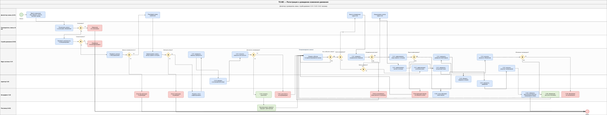
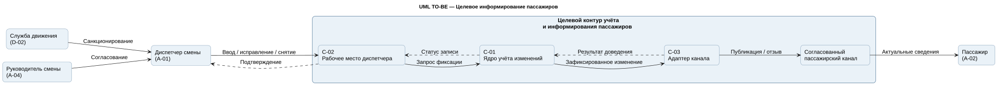
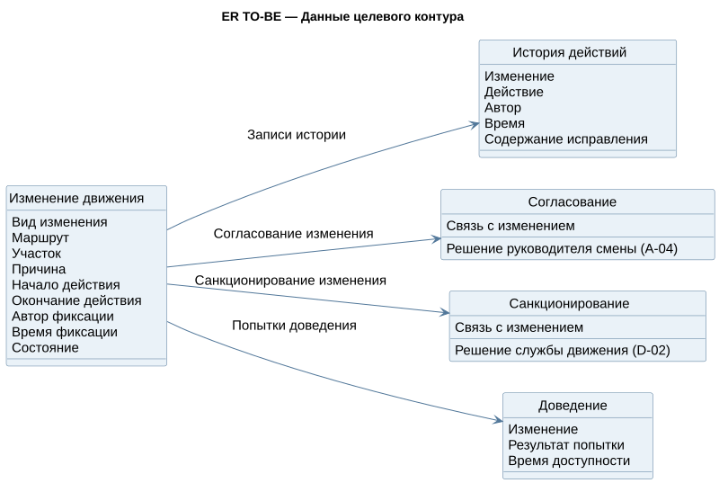

= Целевая модель TO-BE

Тема Т02. Городской общественный транспорт.

В данном разделе представлены модели TO-BE, разработанные в практической работе № 3.

== BPMN TO-BE

Процесс регистрации и доведения изменений движения транспорта.

== UML TO-BE

Целевой контур информирования пассажиров.

== ER TO-BE

Целевая модель данных.

== Связь с документацией

* link:../docs/requirements.adoc[Спецификация требований]
* link:../docs/interface.adoc[Интеграции и интерфейсы]
* link:../README.adoc[Главная страница]
